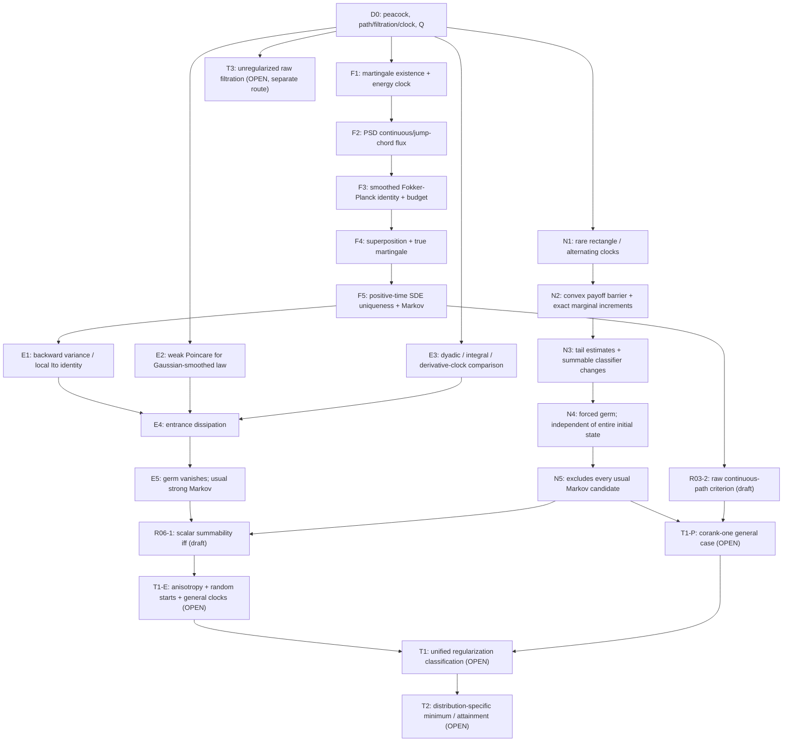
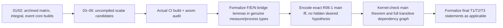

# Proof Graph / 证明依赖图

**Baseline:** round 06, 018fff6704f0722674aecc2349abb14f353f23fe.  
This is a dependency DAG for claims, not a certification that every node has been proved. Status and evidence are in [THEOREM_REGISTRY.md](THEOREM_REGISTRY.md); acceptance gates are in [ACCEPTANCE_CRITERIA.md](ACCEPTANCE_CRITERIA.md). A downstream node inherits the weakest status of an essential dependency. External mathematical results require exact hypotheses checked at the call site.

## 1. Global dependency DAG

The T1 -> T2 edge indicates a useful research input, not logical implication; no edge T1 -> T3 is licensed. The necessity route excludes ordinary Markov under usual filtration; the sufficiency route aims at continuous strong Markov. The equivalence combines these two different strength conclusions under identical hypotheses.

## 2. Node obligations and audit points

| Node | Mathematical obligation | Current basis / next required check |
|---|---|---|
| D0 | Exact definitions, quantifiers and model class | Master plan §1. Keep raw/usual, ordinary/strong, physical/energy clock, continuous/jumping distinct. |
| F1 | Realize general peacock by square-integrable martingale; prove energy continuity and time normalization | Hirsch–Roynette existence; convex-tail uniform integrability, regularization. Cite exact theorem/version and ensure the required cadlag version. |
| F2 | Construct finite PSD matrix measure from continuous bracket and jump-chord Taylor identity; disintegrate in clock time | R02 fixed-kernel §3 and R06 §3. Check measurability, signed entries dominated by trace, martingale compensation, covariance identity and trace time marginal. |
| F3 | Differentiate time-dependent Gaussian convolution and preserve exact weak equation at singular initial time | R03 §3, R06 §3. Check cutoff approximation, time-dependent test functions, boundary at zero and finite trace budget. |
| F4 | Apply Trevisan superposition; upgrade to genuine L2 martingale; all target marginals | Verify narrow continuity, coefficient integrability, weak equation and probability initial law; no Markov inference from superposition alone. |
| F5 | Positive-time local uniqueness and transition measurability; actual nonexplosion; strong Markov at positive stopping times | R02–R06. Separate proof using degenerate PSD square-root regularity from uniformly elliptic proof. Do not assume global conservative solution from exceptional states. |
| E1 | Conditional predictions H_t=h(t,M_t), variance increment equals integrated grad h^T a grad h | R06 §4. Review PDE hypotheses for time-measurable coefficients, compact exhaustion, cutoff convergence under actual law, Sobolev Ito via mollification and localization. |
| E2 | For bounded f and Gaussian smoothing, weak Poincare with controlled tails | R06 §5. Check Gaussian density upper/lower comparison, weighted integration, unweighted Poincare constant, scaling t, and random-start conditional analogue if attempted. |
| E3 | Convert all-C dyadic divergence to integral divergence; convert dt/t to q'(t)dt/t | R06 §2. Check monotonicity, auxiliary t+q(t) clock, endpoint terms and absolute continuity; cannot compare at a fixed C without constants. |
| E4 | Nonzero initial defect forces infinite bounded-prediction variance dissipation | R06 §6. Require a>=q'I, choose tail cutoff by the assumed defect, verify all integrals and positivity. For matrices, establish actual directional coercivity; do not simply replace q by lambda_min(Q) without proof. |
| E5 | Zero defect for tests implies usual-filtration Markov at zero and, combined with F5, strong Markov | R03 entrance criterion and R06 §6. Use determining class and reverse martingale theorem. For random starts seek equality conditional on X_0, not triviality of the entire germ. |
| N1 | Explicit base peacock; monotone clocks, rare mass and energy bound | R06 §7; check all convex tests by interpolation and mixture/product, continuity, and exact energy. |
| N2 | Convex Bregman crossing inequality and affine-region barrier | R04/R05/R06. Payoff at frozen direction identical before noise; centered-noise Jensen gives one-sided price bound. |
| N3 | Gaussian/truncated-tail estimates, threshold changes, symmetric-difference bounds, summability | R05 §4–6, R06 §7. Check tail constants, all endpoints and non-Gaussian optional generalization. No cross-time latent label on candidate space. |
| N4 | Nontrivial event A in germ; independence conditional on full X_0 as required | R02/R05/R06. Borel–Cantelli and bounded-continuous test argument for transverse initial coordinates. Projection need not be Markov. |
| N5 | Contradict ordinary Markov at zero under usual filtration for all candidates | Conditional expectation gives p=p^2 for 0<p<1. Does not exclude raw Markov since F^0_0=sigma(X_0). |
| R06-1 | Both directions under identical scalar assumptions | E1–E5 and N1–N5; draft, no full Lean proof. |
| G1/G2 | Generalize without losing quantifier scope | OPEN. Separate matrix spectral/directional geometry, corank one, random initial and singular clocks into registered lemmas. |
| T2 | Explicit admissible repair class and cost, sharp bound and attainment | OPEN; avoid claiming positive optimum for unrestricted zero-infimum class. |
| R0 | Raw-filtration solution or obstruction independent of usual germ | OPEN. Require exact published question and eligible path class. |

## 3. External theorem dependency ledger

| ID | External result (starting reference) | Required before acceptance |
|---|---|---|
| EXT-HR | Hirsch–Roynette, On R^d-valued peacocks, 2013 | Exact statement, version, regularity and martingale-path assumptions |
| EXT-TREV | Trevisan, Well-posedness of multidimensional diffusion processes with weakly differentiable coefficients, 2016, superposition principle | Match integrability of coefficients and weak equation, existence with all marginals |
| EXT-SDE | Localized SDE existence/pathwise uniqueness and Yamada–Watanabe; time-space strong Markov | Pin exact reference and hypotheses; nonexplosion under entrance law, conditioning at stopping times |
| EXT-SQRT | Local Lipschitz estimate for square root of C^2 PSD matrix fields | Quantitative dependence on local C^2 bounds and time integrability; distinguish degenerate case |
| EXT-PDE | Kim–Krylov, parabolic equations with measurable coefficients, 2007 | Precise W^{1,2}_p regularity theorem, coefficient classes, localization and probabilistic representation |
| EXT-LOW | Lowther, Fitting Martingales To Given Marginals, arXiv:0808.2319 | Exact continuity, support, measurable family and filtration conventions |
| EXT-PRS | Pammer–Robinson–Schachermayer, DOI 10.1214/24-AAP2125 | Compare hypotheses and conclusions, quote exact raw-filtration question in published version |

The citations are pointers for verification, not a list of imported formal Lean theorems. For each use add theorem number/page, exact hypothesis check and version to the next audit. If a dependency is absent from Mathlib, provide an actual formal proof or explicitly record the bridge as unformalized; a custom axiom is not a substitute.

## 4. Formalization graph

C is not yet evidenced for rounds 03–06. D–G are not done. Formalizing a scalar inequality such as p != p*p is not a proof of N4 or N5; proving a finite-dimensional surrogate is not a proof of R06-1. See acceptance levels for the difference between kernel-checking a lemma, a conditional theorem, and the full claim.

## 5. Agent update rule

Every new lemma gets a stable ID, exact statement, prerequisites, evidence, status and downstream effect. Add arrows before claiming a dependent theorem. If a dependency is refuted or a citation hypothesis fails, mark every affected descendant BLOCKED until repaired. Do not count the proof graph itself as proof progress. Maintain a proof-gap list with a testable statement for each missing edge.
